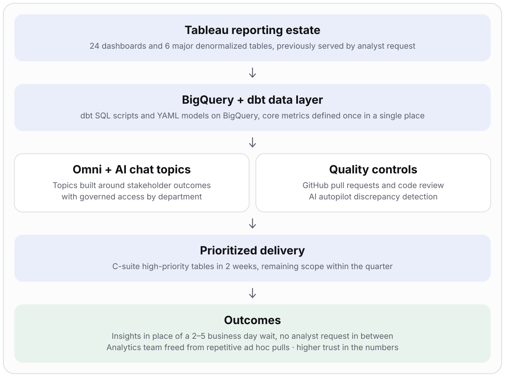
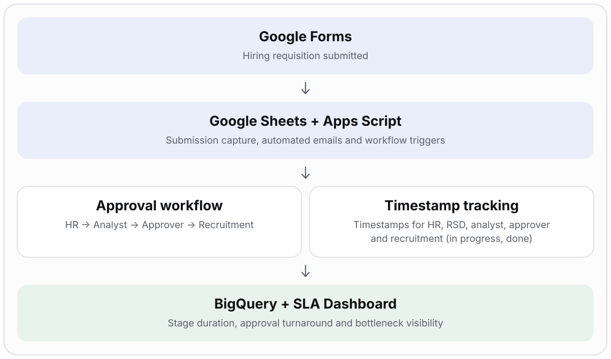
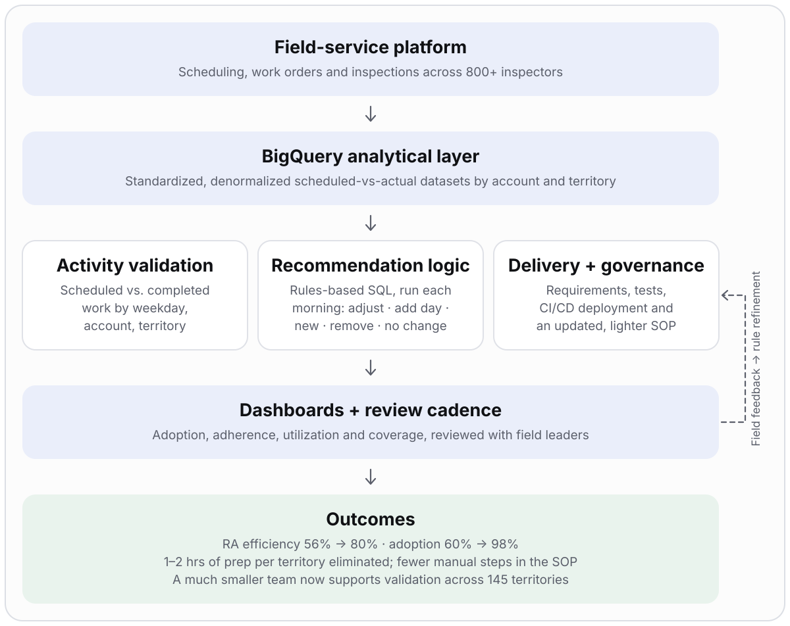
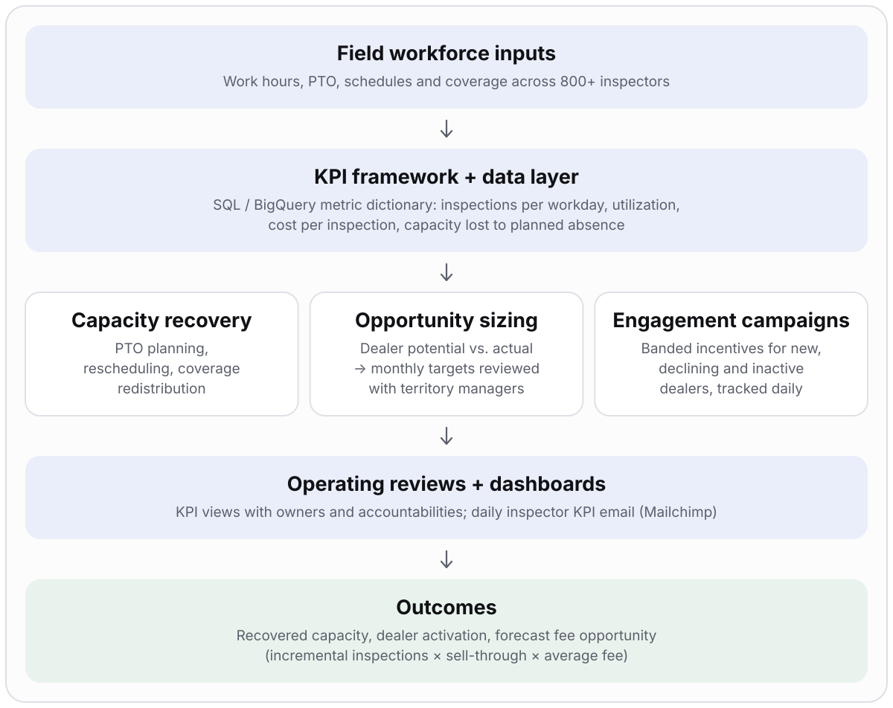
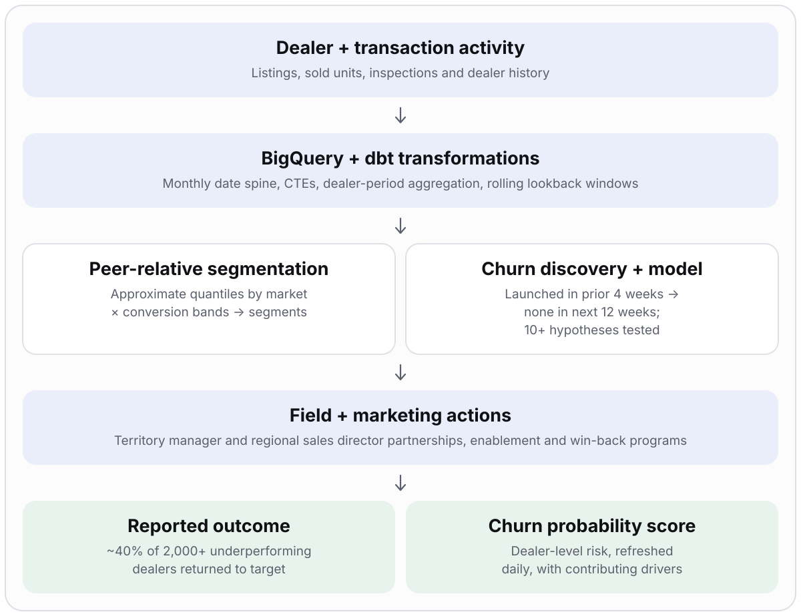
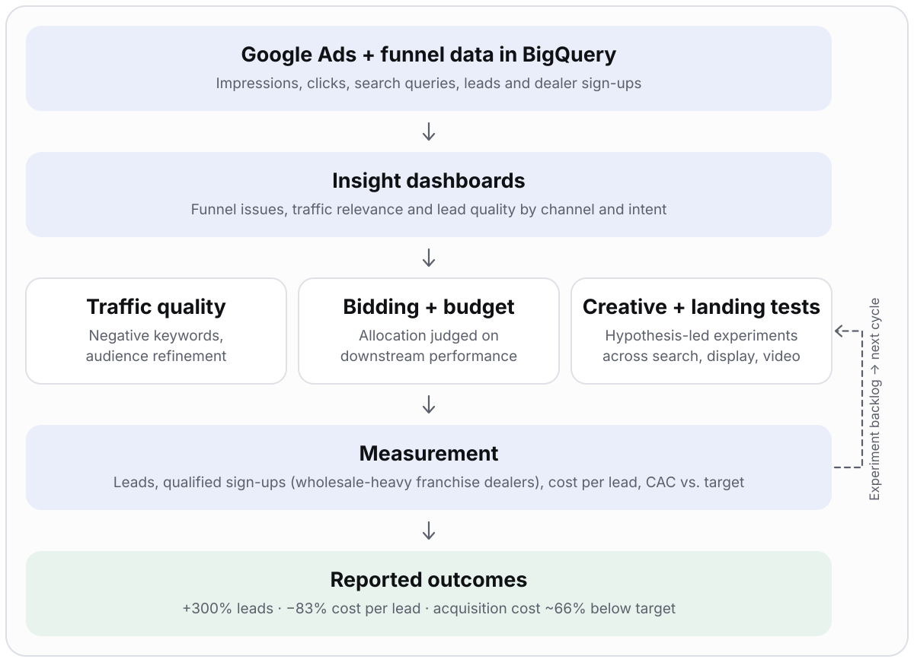

# Karthik Vemula

**Senior Analyst (Market Strategy & Analytics) · Technical Program Management · Operations & Analytics Programs at Scale**

I take ambiguous, cross-functional problems and turn them into programs that run on their own: define the decision, build the mechanism (workflow, data model, automation), land it across teams, and instrument it so the results are measurable.

8+ years running programs that span Operations, Sales, Product, Engineering, Analytics, HR and Finance, with a focus on workforce planning, field operations, GenAI/AI-enabled delivery and data-driven decision systems. Previously at Amazon; MBA in Operations & Supply Chain Management.

---

## Impact at a glance

*Outcomes as reported in the original program notes. Attribution and caveats are on each case-study page.*

| | | |
|:---:|:---:|:---:|
| **60% → 98%** field-service platform adoption across **800+** inspectors | **56% → 80%** appointment efficiency after recommendation automation | **2–3 months → 15 business days** hiring request-to-hire, with approval cut from **2 weeks to 1–2 business days** |
| **5+ business functions** run on the field-ops validation dashboard | **~40% of 2,000+** underperforming dealers returned to target performance | **~145 territories** supported by automated validation instead of manual prep |

---

## Program portfolio

<table>
<tr>
<td width="46%" valign="top">

### [AI-Enabled Analytics Delivery (Tableau to Omni)](./ai-analytics-migration/)
Led the migration of Sales Ops and Field Analytics reporting into an AI analytics platform: 6 denormalized tables and 24 dashboards rebuilt on a governed dbt layer, so leaders get answers in place of a 2–5 business day request cycle.

**Signal:** AI-enabled delivery · scoping and prioritization · metric governance · access design · quality controls
**Stack:** BigQuery · dbt · Omni · Tableau · GitHub

</td>
<td width="54%"></td>
</tr>
<tr>
<td width="46%" valign="top">

### [Hiring Intake & SLA Automation](./workforce-planning-automation/)
Rebuilt a manual, email-driven hiring-requisition process into an auditable workflow with an owner per stage, automated notifications, stage-level SLA timestamps and a Tableau SLA view.

**Signal:** process redesign · workflow orchestration · SLA instrumentation · exec alignment
**Stack:** Forms · Sheets · Apps Script · BigQuery · Tableau

</td>
<td width="54%"></td>
</tr>
<tr>
<td width="46%" valign="top">

### [Field Operations & Scheduling Optimization](./field-operations-optimization/)
Recovered platform adoption from ~60% to 98% and automated appointment validation and recommendations (rules-based SQL refreshed every morning), working through Analytics Engineering.

**Signal:** end-to-end ownership · adoption recovery · requirements engineering · analytics-to-product translation · phased rollout
**Stack:** BigQuery · Tableau · field-service workflows

</td>
<td width="54%"></td>
</tr>
<tr>
<td width="46%" valign="top">

### [Field Workforce Productivity & Revenue](./field-workforce-productivity/)
Owned the KPI framework, capacity-recovery plan, banded incentive campaigns, a daily KPI email and opportunity sizing for an 800+ person field workforce, with continuous territory-manager review cycles.

**Signal:** KPI architecture · capacity planning · incentive design · opportunity sizing
**Stack:** SQL/BigQuery · Tableau · spreadsheets

</td>
<td width="54%"></td>
</tr>
<tr>
<td width="46%" valign="top">

### [Dealer Performance & Retention Intelligence](./dealer-performance-intelligence/)
A monthly A/B/E dealer grading framework, a four-stream churn program (field, dealer calls, data, generative AI) and retention programs that recovered roughly a quarter of lost "dark" dealer volume, plus a dealer-level churn probability score refreshed daily.

**Signal:** end-to-end ownership · hypothesis-led problem solving · grading and churn modeling · generative AI for field insight · retention program design
**Stack:** BigQuery · dbt · SQL · Tableau · Salesforce

</td>
<td width="54%"></td>
</tr>
</table>

## Add-on project

<table>
<tr>
<td width="46%" valign="top">

### [B2B Customer Acquisition Optimization (add-on)](./b2b-acquisition-analytics/)
Insights lead for a Google Ads acquisition program: integrated marketing data into BigQuery and built the dashboards that raised lead volume and quality while cutting cost per lead.

**Signal:** data integration · funnel measurement · experimentation · data-led resource allocation
**Stack:** Google Ads · BigQuery · dashboards

</td>
<td width="54%"></td>
</tr>
</table>

*A supporting analytics engagement outside my core program-management work. Reported outcomes: +300% leads, −83% cost per lead, acquisition cost ~66% below target.*

---

## How I run programs

1. **Define the decision first.** What will someone do differently because of this? If there is no action, there is no program.
2. **Baseline and instrument.** Map the as-is, measure where time and effort go, and put timestamps and metric definitions in place before changing anything.
3. **Turn judgment into requirements.** Document what experts decide, with what evidence, and which edge cases exist, before automating anything.
4. **Deliver in phases with exit criteria.** Validate against real scenarios before rollout; keep logic explainable so operators trust it.
5. **Govern the cadence.** Named owners, WBR/MBR/QBR reviews, feedback loops, and a clear release path for future changes.
6. **Measure honestly.** Use baselines and comparison groups where possible, and separate what the program caused from what happened alongside it.

---

## What these projects demonstrate

| Signal | Evidence |
|---|---|
| **Scope & ambiguity.** Owns problem definition, not just execution | Framed the adoption-decline problem and the hiring-process problem from symptoms, then defined the target state, KPIs and rollout |
| **Technical depth.** Credible with engineers and data teams | BigQuery/dbt segmentation patterns; a dbt-to-Omni migration with governed AI access; event-driven Apps Script automation; requirements and edge cases for a recommendation engine |
| **Mechanisms, not heroics.** Builds things that keep working | Stage-level SLA timestamps; metric dictionaries with owners; a recommendation job that runs every morning; a daily inspector-KPI email to the whole field; a churn score refreshed daily; metrics defined once and reused across AI chat; recurring review cadences |
| **Influence without authority.** Aligns many orgs | Sales, Operations, HR, Product, Engineering, Analytics and field leadership; dealer turnaround delivered through territory managers and regional sales directors |
| **Rigor with data.** Careful about causality | Hypothesis backlogs, time-based validation, baselines and comparison groups, explicit assumption labelling |
| **Risk & dependency management.** De-risks before scaling | Phased delivery, validation against field scenarios, acceptance criteria, repeatable release path |
| **Executive communication.** Makes decisions easy to take | Governance reviews (WBR/MBR/QBR), opportunity-sizing math that leadership can audit |

**Roles this maps to:** Technical Program Manager · Senior Program Manager · Business Operations / Strategy & Operations · Workforce Planning & Analytics.

---

## Toolkit

**Data & analytics:** SQL · BigQuery · dbt · Omni (AI analytics) · Tableau · Excel / Sheets modeling · forecasting and labor modeling
**Automation:** Google Apps Script · workflow design · event-driven triggers · GenAI-enabled delivery
**Program craft:** roadmaps, RACI, risk registers, KPI frameworks, change management, WBR/MBR/QBR governance, Agile delivery

---

## Terms used

**VCI** Vehicle Condition Inspector · **TM** territory manager · **RSD** regional sales director · **SLA** service-level agreement

---

## About this repository

Each project page follows the same structure: problem, what I owned, architecture, delivery plan, key decisions, risks, results and the signals it demonstrates. `methodology.md` in each folder explains the approach in repeatable steps.

All content is generalized from professional experience. Employer-owned source code, confidential datasets, customer and employee information, internal identifiers, proprietary rules and sensitive financial results are excluded. Metrics are reported outcomes and are labelled as such.
