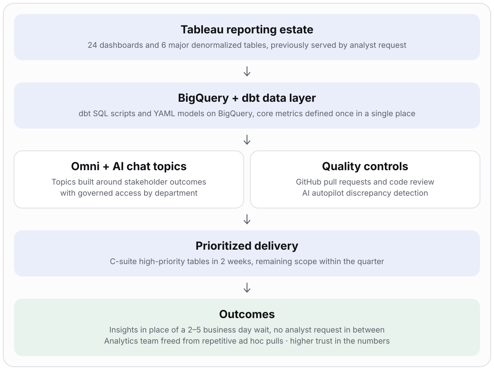

# AI-Enabled Analytics Delivery: Tableau to Omni Migration

> **Leaders went from waiting 2–5 business days for Sales Ops and Field Analytics answers to getting insights almost immediately, with no analyst request in between** (reported outcome). High-priority C-suite tables landed within a 2-week window.

| | |
|---|---|
| **Role** | Program lead: scoped and prioritized the migration with data engineers and senior leaders, owned the roadmap, governance model, AI topic setup and quality controls |
| **Partners** | Data engineers, C-suite and senior leaders, Sales Ops and Field Analytics stakeholders |
| **Stack** | BigQuery (primary warehouse) · dbt (SQL + YAML) · Omni (AI analytics platform) · Tableau (source) · GitHub (pull requests and code review) |
| **Scope** | 6 major denormalized data tables · 24 Tableau dashboards |
| **Timeline** | 2 weeks for the C-suite's high-priority tables; the remainder within the quarter |

> Generalized from professional experience. Internal data models, metric definitions, dashboards and access rules are excluded.

## Problem

C-suite and senior leaders had to submit a request to get Sales Ops and Field Analytics data. Understanding the ask and pulling the numbers took **2–5 business days**, with several operational layers in between. The delay slowed decisions, and the analytics team spent its time on repetitive ad hoc pulls.

## What I owned

- Scoping and prioritization with data engineers and senior leaders, sequencing the C-suite's priority reporting first
- The migration roadmap: **6 major denormalized tables** and **24 Tableau dashboards**
- A single home for core metric definitions so everyone works from one definition
- AI chat topics built around the outcomes stakeholders asked for, with logic rules so access is governed correctly across departments
- Quality controls: code review on every change and automated discrepancy detection

## Architecture

## Delivery plan

| Phase | Work | Exit criterion |
|---|---|---|
| 1. Scope | Inventory dashboards and tables with data engineers; agree priorities with senior leaders | Prioritized roadmap, C-suite items first |
| 2. Build data layer | dbt SQL scripts and YAML on BigQuery for the denormalized tables; core metrics defined once | Tables and metrics reviewed and merged |
| 3. Enable AI self-serve | AI chat topics per stakeholder outcome; governed access logic by department | Leaders can ask and get answers within their permissions |
| 4. Validate | Pull request review plus AI autopilot discrepancy detection against existing reporting | Mismatches resolved before release |
| 5. Deliver | C-suite high-priority tables within 2 weeks; remaining tables and dashboards within the quarter | Priority reporting live, then full migration scope |

## Key decisions and trade-offs

| Decision | Why | Trade-off |
|---|---|---|
| Sequence the C-suite's priority tables first | Fastest path to visible value and to the tightest deadline | Lower-priority dashboards wait for later in the quarter |
| Define metrics once in the data layer | One definition means consistent answers across AI chat and reporting | Needs agreement on definitions up front |
| Govern access with logic rules per department | Self-serve AI must respect who can see what | More setup effort per topic |
| Code review through GitHub pull requests | Data logic gets the same discipline as software | Slightly slower than ad hoc edits |
| Automated discrepancy detection during migration | Catches data mismatches early, before leaders see them | Requires a baseline to compare against |

## Risks and how they were handled

| Risk | Mitigation |
|---|---|
| Migrated numbers differ from trusted dashboards | Discrepancy detection and code review before release |
| Inconsistent metric definitions across teams | Core metrics centralized in one place |
| Self-serve AI exposes data to the wrong audience | Logic rules governing access by department |
| Tight timeline for executive reporting | Strict prioritization, C-suite tables first |

## Results (reported)

- Wait time for leadership insights fell from **2–5 business days** to almost immediate, with no analyst request in between
- High-priority C-suite tables delivered within the **2-week** window
- Removing the request-and-pull layers cut latency and freed the analytics team from repetitive ad hoc pulls
- Centralized metric definitions and automated discrepancy checks improved trust in the numbers

## Signals this demonstrates

AI-enabled delivery · program scoping and prioritization · data-platform migration · metric governance · access control design · quality controls · executive stakeholder alignment

## Confidentiality

No internal table names, metric formulas, dashboards, access rules, source code or company data are included.
