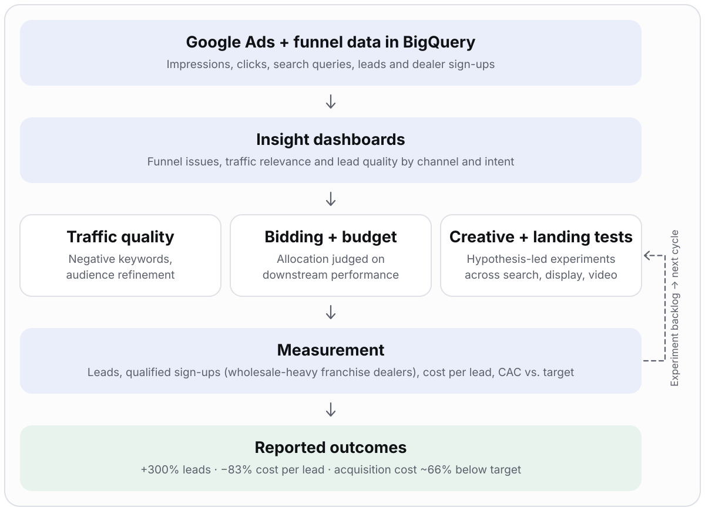

# B2B Customer Acquisition Optimization

> **+300% leads, −83% cost per lead, acquisition cost ~66% below target** (reported outcomes) by tightening traffic quality and running a disciplined optimization loop.

| | |
|---|---|
| **Role** | Insights lead: integrated all marketing data into BigQuery and built the dashboards that identified funnel problems and areas to improve, feeding the continuous optimization cycle |
| **Partners** | Marketing, Sales |
| **Focus** | Google Ads search, display and video acquisition for wholesale dealer buyers and sellers |
| **Stack** | Google Ads · BigQuery · dashboards |

> Internal campaign configurations, customer lists, account identifiers and proprietary marketing data are excluded.

## Problem

Campaigns risked attracting retail consumers instead of qualified dealership buyers and sellers. Campaign-level reporting alone did not show lead quality, funnel conversion, or how optimization decisions related to acquisition economics.

## What I owned

- The **data foundation**: marketing data from all channels integrated into BigQuery
- Dashboards showing where the funnel leaked and which levers to pull
- A shared definition of a **qualified lead**: a dealer sign-up from a wholesale-heavy (franchise) dealer
- The measurement framework linking execution metrics to acquisition goals
- Input to the prioritized experiment backlog and review rhythm

## Architecture

## Approach

| Lever | What was done |
|---|---|
| Traffic relevance | Branded and non-branded keyword and search-query review; stronger negative-keyword and audience targeting |
| Bidding and budget | Automated bidding and campaign allocation evaluated on downstream performance, not click volume |
| Formats | Targeted search, display and video campaigns for dealer audiences |
| Experiments | Creative and landing-page tests with explicit hypotheses tied to leads and cost per lead |

## Measurement framework

| Funnel stage | Example measures |
|---|---|
| Reach | Impressions, eligible audience reach |
| Engagement | Click-through rate, search-query relevance |
| Acquisition | Leads, cost per lead |
| Qualification | Qualified-lead rate (wholesale-heavy franchise dealer sign-ups), lead-to-customer conversion |
| Economics | Customer acquisition cost, cost vs. target |

## Key decisions and trade-offs

| Decision | Why | Trade-off |
|---|---|---|
| Optimize to qualified leads, not raw leads | Cheap leads from the wrong audience are not cheap | Fewer vanity wins, slower reporting |
| Align Marketing and Sales on the definition of success first | Removes disagreement over what a good lead is | Needs early negotiation |
| Prioritize experiments by expected impact and effort | Limited budget and capacity | Some ideas wait |
| Document attribution assumptions | Several changes ran at once | Results are described as associated with, not caused by |

## Risks and how they were handled

| Risk | Mitigation |
|---|---|
| Retail traffic dilutes lead quality | Negative keywords, audience refinement, query review |
| Optimizing to a proxy metric | Judge bidding and creative on downstream qualification and cost |
| Overclaiming causality | Document assumptions; no single change is credited with the whole improvement |

## Results (reported)

- **300%** increase in total leads
- **83%** reduction in cost per lead
- Acquisition cost about **66%** below the target benchmark

These are outcomes from the original case notes, not independently verified causal estimates.

## Signals this demonstrates

Growth analytics · data integration and dashboarding · funnel measurement · experimentation discipline · data-led resource allocation · stakeholder communication

## Confidentiality

No internal campaign names, keywords, spend, customer-level data, advertising account identifiers or proprietary targeting configurations are included.
