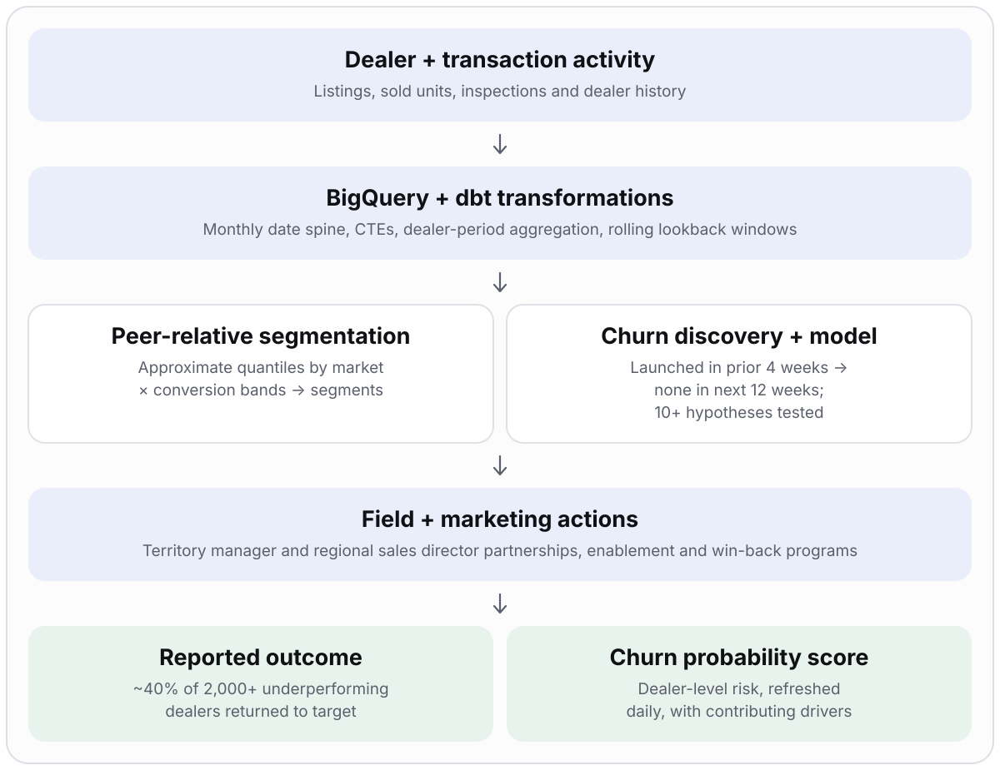
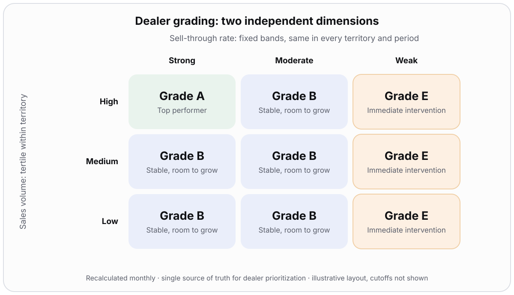

# Dealer Performance & Retention Intelligence

> **A shared way to prioritize and retain dealer accounts:** a dealer grading framework (A / B / E) run monthly, a four-stream churn program, and a dealer-level churn probability score refreshed daily. About **40% of 2,000+ underperforming dealers returned to target performance**, and re-engagement programs recovered roughly **25% of the volume previously lost to churned ("dark") dealers** (reported outcomes).

| | |
|---|---|
| **Role** | **End-to-end program owner.** I was the single owner orchestrating the whole dealer program: problem definition, grading framework, churn discovery across four streams, hypothesis development, retention programs and operational adoption |
| **Partners** | Analytics, Sales (territory managers, regional sales directors), Logistics, Customer Experience; hypotheses spanned Arbitration, Pricing, Payments, Onboarding, Customer Service |
| **Stack** | BigQuery · dbt · SQL · Tableau · Salesforce (including territory manager visit logs) · generative AI for log analysis |
| **Status** | Delivered: grading framework, four-stream churn discovery, retention programs, and a dealer-level churn probability score, refreshed daily |

> Exact thresholds, lookback windows, exclusions and production implementation are intentionally omitted. No raw dealer data or production SQL is published.

## Problem

A single performance indicator did not reflect differences in dealer scale, territory demand or growth potential. Teams also lacked a consistent, evidence-based explanation for why dealers went inactive or fell into lower segments.

## What I owned

- The decision framing: which accounts to protect, which to develop, which need intervention
- Segmentation design with field leaders so categories were understandable and actionable
- The churn program structure, cohort definition and hypothesis process across functions
- The review mechanism that turns segments into account prioritization and enablement

## Architecture

## Part 1: Dealer grading framework

I designed a grading mechanism from two independent dimensions and combined them in a matrix.

| Dimension | How it works | Why |
|---|---|---|
| **Sales volume** (relative, territory-based) | Dealers are ranked within their own territory on recent sales and split into tertiles: high, medium, low | A fair, apples-to-apples comparison across territories with different demand levels |
| **Sell-through rate** (absolute thresholds) | Dealers are grouped using fixed sell-through bands | The same bands apply in every territory and period, so grades stay consistent over time |

| Grade | Meaning | Use |
|---|---|---|
| **A** | Top performer: strong demand and efficient conversion | Protect and learn from |
| **B** | Stable fundamentals with clear room to grow | Develop |
| **E** | Conversion inefficiency, whatever the sales volume | Immediate intervention |

Working with Sales, Analytics and Ops, I put this into operation as a **monthly mechanism** and established it as the **single source of truth for dealer prioritization**. Grades are kept as monthly snapshots, so upgrades, declines and sustained inactivity are visible over time.

## Part 2: Churn program, four streams run in parallel

I led this end to end and took a simultaneous, multi-angle approach to find out why dealers stopped transacting.

| Stream | What I did |
|---|---|
| **1. Field perspective** | Sent a monthly list of churned dealers to every territory sales leader and had them record likely churn reasons, with as much detail as possible on the roadblocks the field saw |
| **2. Dealer feedback** | Partnered with the logistics call-center team to call each dealer that had stopped transacting for a full quarter and ask why |
| **3. Data-driven framework** | Partnered with analytics engineers and analysts to define **early churn** and build the model (below) |
| **4. Generative AI** | Applied generative AI to territory manager visit logs in Salesforce (a record of every dealer visit) to surface and validate trends from the field's own notes |

### Stream 3: the early-churn framework and score

| Item | Definition |
|---|---|
| Observation cohort | Dealers with at least one vehicle launched in the preceding 4 weeks |
| Target outcome | No launches in the following 12 weeks, defined as **early churn** |
| Hypothesis process | A working session with Sales, Analytics, Logistics and Customer Experience to list possible causes, then hypothesis testing across **10+ assumptions**, prioritized high / medium / low |
| Primary use | Help territory managers and Vehicle Condition Inspectors (VCIs) prioritize and look closely at lister dealers at risk of churn |
| Secondary use | Increase marketing engagement |
| Output | **Dealer-level churn probability score** (the second phase of the data-driven stream) with the hypothesis-driven factors contributing to each dealer's risk |

| Theme | Candidate signals |
|---|---|
| Arbitration | Buy-side and sell-side share, unwound sales |
| Sales and engagement | Historical sell-through, listing price vs. market benchmark, days since contact, visit history |
| Service and coverage | Representative changes, proximity to field coverage, response to visit requests |
| Vehicle process | Time to sell, time from request to sale, red-light vehicle share |
| Pricing and payments | Competitor price differences, seller payment delays |
| Onboarding and access | Onboarding experience, title-fee experience, revoked selling access |

The hypothesis list is the candidate-feature backlog; not every candidate necessarily became a model input.

### What the four streams found

The top-level churn reasons were consistent across the field, dealer and data views:

- **Lost to a competitor**
- **Lack of VCI and territory manager coverage**
- **A poor buy or sell experience**

### What we did about it

Re-engagement programs aimed at those reasons: **guaranteed-sale programs**, **buy and sell fee reductions**, and **transportation credits**, delivered through territory managers and regional sales directors using existing churn-incentive credit programs.

## Delivery plan

| Phase | Work | Status |
|---|---|---|
| Segmentation | Matrix framework, review cadence, field adoption | Delivered |
| I. EDA | Identify the primary causes of seller churn | Delivered |
| II. Action planning | Define interventions from the four streams' findings (guaranteed-sale programs, fee reductions, transportation credits, coverage, enablement, win-back) | Delivered |
| III. Model build | Prediction model for 12-week inactivity, output as a dealer-level churn probability score with contributing factors, refreshed daily | Delivered |
| Field execution | Territory managers and regional sales directors act on at-risk and underperforming dealers through strategic partnerships | Ongoing |

## Key decisions and trade-offs

| Decision | Why | Trade-off |
|---|---|---|
| Two independent dimensions instead of one score | One score hides scale vs. effectiveness differences | A matrix is slightly harder to explain, so grades were co-designed with field leaders |
| Relative volume tertiles, absolute sell-through bands | Territory demand differs, but conversion should be judged the same everywhere | Needs checks for territory effects and small groups |
| EDA and action planning before model building | Interventions could start before a model existed; avoids a score with no action | Prediction arrived later |
| Show the contributing factors with every score | Field teams act on the reason (coverage, pricing, service), not a bare number | More to explain and maintain |
| Separate observation and outcome windows | Prevents target leakage | Requires strict as-of-date feature availability |
| Triangulate field, dealer, quantitative and generative AI evidence | Avoids relying on one biased view | More cross-functional coordination |

## Risks and validation approach

| Risk | Mitigation |
|---|---|
| Gradual decline vs. abrupt stop behave differently | Handle both patterns in feature design and validation |
| Future-information leakage | Use only features available at the observation date |
| Signals add nothing beyond simple recency | Test incremental value against recency and history baselines |
| Instability across territories or segments | Check missingness, stability over time and territory effects |
| Correlation read as cause | Distinguish correlation from causation; track whether interventions change behavior |
| Score trusted before it is proven | Validate the 12-week outcome on time-based holdouts before operational use |

## Results (reported)

- Grading became a common, monthly prioritization mechanism across the organization
- Baseline of **2,000+ underperforming dealers** month over month; about **40% returned to target performance** through strategic partnerships executed by territory managers and regional sales directors
- Churn fell after the retention programs, with roughly **25% additional sales recovered from "dark" dealers** (see how this was measured below)
- Dealer-level churn probability score with contributing factors, supporting earlier intervention

### How the 25% was measured

1. **Baseline:** the annual volume lost from dealers who churned and never came back ("dark" dealers), volume that had never been counted in sales.
2. **Intervention:** re-engage those dealers using the existing churn-incentive credit programs.
3. **Result:** the volume reactivated, compared with that lost baseline, is the roughly 25% recovery. Commission earned on the reactivated volume came through buy and sell fees.

Actual unit counts and dollar figures are confidential and not published.

## Signals this demonstrates

Analytics strategy · dealer grading · churn modeling · generative AI for field insight · hypothesis-led problem solving · retention program design · technical depth in SQL/dbt · phased delivery · stakeholder alignment · operational adoption

## Confidentiality

No raw dealer data, account identifiers, production SQL, internal thresholds, exclusion rules or proprietary model features are published.
