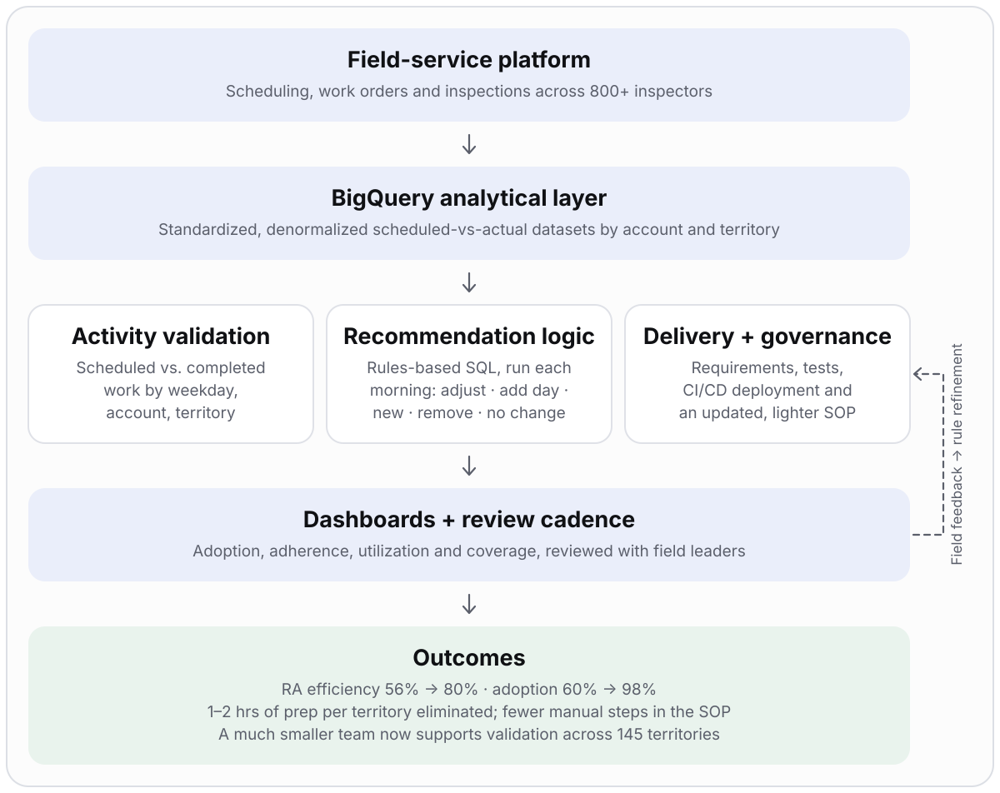

# Field Operations & Scheduling Optimization

> **Platform adoption recovered from ~60% to 98% across 800+ inspectors, and RA (appointment) efficiency raised from ~56% to 80%** (reported outcomes) through activity validation, then recommendation automation.

| | |
|---|---|
| **Role** | **End-to-end program owner.** Owned the problem, program architecture, requirements, KPI framework, stakeholder alignment, delivery plan, validation, rollout, CI/CD release path and ongoing SOP, with Analytics Engineering partnering on the build |
| **Partners** | Analytics Engineering, field leadership, regional analysts |
| **Stack** | BigQuery / SQL (rules-based, refreshed every morning) · Tableau · field-service workflows |
| **Scale** | 800+ inspectors · ~145 territories · 50,000+ wholesale units |

> Generalized from professional experience. Proprietary scheduling rules, account-level recommendations, data models and screenshots are excluded.

## Problem

After a field-service platform rollout across 800+ inspectors, adoption reached about **88%** and then slipped to around **60%**. The root causes were inconsistent schedules and a lack of daily route planning, plus manual work-order creation and upkeep of dispatch rules. Together they made it hard to know what inspectors were scheduled to do versus what actually happened.

A later organizational restructuring reduced analytical capacity, so manual account-by-account validation across a large territory footprint could not be sustained.

## What I owned

This was an ownership program from start to finish: I identified the problem, defined the solution, drove delivery, and run it in operation.

- Framing the problem as two linked workstreams: **trust the data**, then **automate the judgment**
- KPI definitions and owners: adoption, schedule adherence, productivity, capacity utilization, coverage, appointment efficiency
- Requirements for the recommendation logic, converted from analyst judgment and edge cases
- Phased delivery plan, validation criteria, and rollout/change governance
- The recurring review cadence between regional analysts and field leaders

## Architecture

## Two workstreams

### 1. Field activity validation
- Centralized analytical view that reconciles scheduled service activity with actual field activity
- Weekday- and account-level visibility into completed work and appointment alignment
- Recurring reviews between regional analysts and field leaders; feedback loop for usability and configuration issues

### 2. Appointment recommendation automation
The manual validation process was decomposed into five explainable account-level outcomes. The logic is **rules-based SQL that runs every morning** and is delivered through the dashboard. The rules were built from the recurring calls I ran with sales leaders, who had been validating accounts manually, so the automation encodes the same judgment they already used:

| Outcome | Meaning |
|---|---|
| Adjust | Change an existing appointment |
| Add day | Add an appointment day |
| New | Recommend a new appointment |
| Remove | Remove an appointment |
| No change | Current plan is right |

## Delivery plan

| Phase | Work | Exit criterion |
|---|---|---|
| 1. Baseline | Measure adoption; separate "system used" from "schedule quality" | Shared baseline and KPI definitions |
| 2. Target state | Design the validation view and the recommendation outcomes | Stakeholder sign-off |
| 3. Data requirements | Define grains, matching criteria, exception categories, denormalized structures | Analytics Engineering confirms feasibility |
| 4. Implementation | Build validation layer, then recommendation framework with Analytics Engineering | Outputs match the judgment sales leaders applied on the recurring calls |
| 5. Validate | Tested on the regular cadence calls with sales leaders against the manual recommendations, then used as a validation layer across ~145 US territories | Sales leaders aligned; automated output judged better and faster |
| 6. Roll out | Training, release ownership, feedback channels, recurring reviews | Recommendations used in operating reviews |
| 7. Sustain | Updated SOP; CI/CD deployment for future logic updates; track data quality and outcomes | Updates ship without rebuilding the process manually |

## Key decisions and trade-offs

| Decision | Why | Trade-off |
|---|---|---|
| Fix visibility before automating | Teams needed one trusted view of plan vs. actual first | Slower to the "automation" headline |
| Document analyst judgment as requirements before building | Avoids automating an undocumented, inconsistent process | Upfront effort with analysts and field leaders |
| Rules-based SQL, refreshed daily, delivered in the dashboard | Operators can read, trust and override each recommendation; no new tool to learn | Simpler than a model-based approach |
| Prioritize highest-value scenarios first | Value arrives earlier and risk stays contained | Some edge cases handled in later releases |
| Deploy logic changes through CI/CD with an updated SOP | Logic will change; releases should not be rebuilt by hand | Governance and pipeline upkeep |

## Risks and how they were handled

| Risk | Mitigation |
|---|---|
| Reduced analytical capacity after restructuring | Automate preparation and validation, not just reporting |
| Recommendations lose field trust | Rules built from sales leaders' own validation calls; explainable outcomes; reviewed with them on the ongoing calls |
| Adoption looks healthy while schedule quality is poor | Measure adherence and appointment efficiency alongside adoption |
| Inconsistent definitions across teams | Published metric definitions with owners |
| Improvement misattributed | Separate platform-adoption gains from gains attributable to the recommendation automation |

## Results (reported)

| Outcome | What changed |
|---|---|
| **RA efficiency 56% → 80%** | Significant improvement in appointment efficiency after recommendation automation |
| **Manual prep eliminated** | The 1–2 hours of preparation per territory before each RA validation call is gone, and the effort to run the calls themselves dropped significantly |
| **Lighter SOP, scalable releases** | The updated SOP needs substantially less manual intervention; CI/CD deployment gives a scalable way to ship future logic updates without rebuilding the process by hand |
| **Smaller team, 145 territories** | A significantly smaller team supports the RA validation process across 145 territories, turning a capacity-constrained process into a scalable, technology-enabled program |

Supporting results:

- Platform adoption **~60% → 98%** across 800+ inspectors
- Validation dashboard used across **5+ business functions**
- About **64% of 50,000+ wholesale units** flowing through the appointment-based process
- Tested on the regular cadence calls with sales leaders, where the automated recommendations proved better than the manual ones and much faster to produce, and **aligned the sales leaders** on one daily view of the plan

## SQL and analytics layer

BigQuery transformations reconcile scheduling and inspection records into one view: standardized records, a common dealership/date/territory context, weekday-level aggregation, and comparison of expected vs. observed activity. Datasets feed Tableau reporting and the recommendation workflow. The source SQL for the recommendation engine was not available, so no specific query operators or model features are claimed for it.

## Signals this demonstrates

Technical program management · requirements engineering · analytics-to-product translation · operational adoption · validation and release planning · managing through reduced capacity

## Confidentiality

No production SQL, data models, recommendation rules, account-level suggestions, thresholds or screenshots are included.
