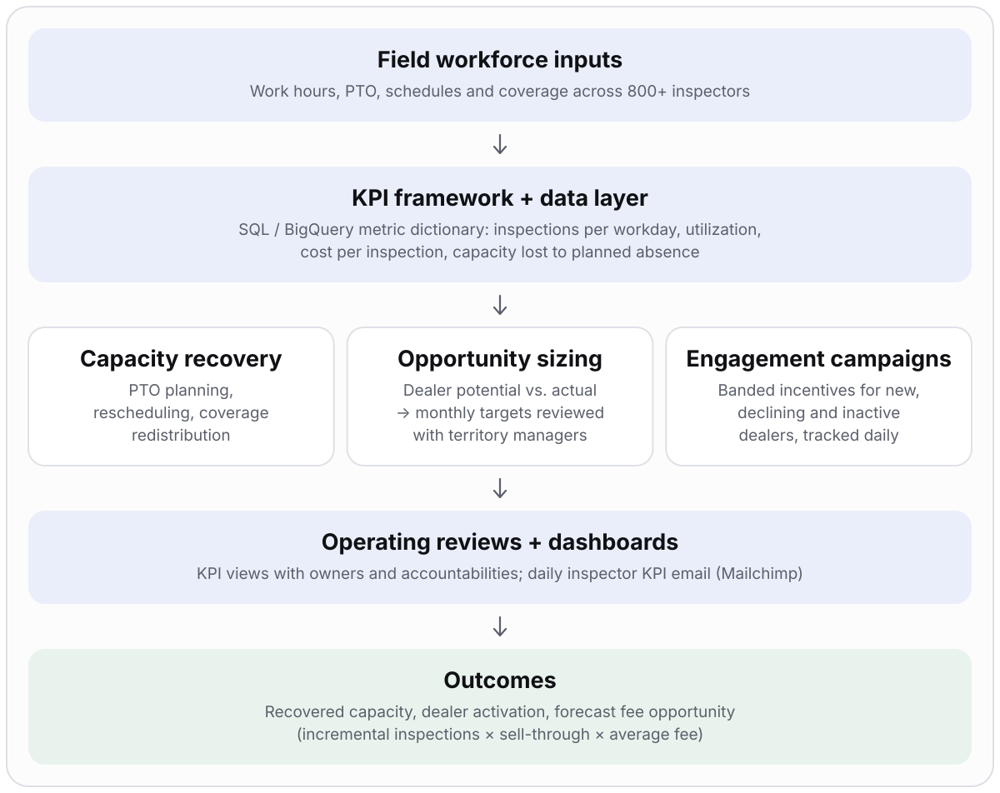

# Field Workforce Productivity & Revenue Optimization

> **One operating system for an 800+ person field workforce:** a shared KPI framework that connects capacity, incentive campaigns and dealer opportunity to monthly field targets.

| | |
|---|---|
| **Role** | Program lead: KPI design, analytics requirements, dashboard delivery, operating reviews, incentive-program measurement |
| **Partners** | Sales, Operations, Product, Engineering, field leadership |
| **Stack** | SQL / BigQuery · Tableau · Salesforce · Mailchimp · spreadsheets |
| **Scale** | Geographically distributed field-inspector workforce of 800+ |

> Operational details and company-specific metrics are generalized. Confidential quantitative and commercial results are omitted.

## Problem

Leaders lacked a consistent view of how available work hours, inspection output, PTO, scheduling gaps and cost per inspection related to dealer opportunity. Separate teams also needed a coordinated way to activate **new, declining and inactive** buyers and sellers without overloading field capacity.

## What I owned

- A **metric dictionary**: numerator, denominator, grain, refresh cadence, owner and intended action for every KPI
- The capacity-recovery plan (PTO planning, rescheduling, coverage redistribution)
- Incentive (SPIFF) campaigns with eligibility rules and **success metrics I defined**
- Translation of dealer-level opportunity into monthly inspection targets, set with field leaders
- Campaign-specific jobs in the field-service platform, built with the Product teams so incentives could be tracked automatically
- A **daily inspector-performance KPI email** to the whole field (Mailchimp, fed by Tableau and Salesforce metrics)
- Continuous review cycles with territory managers showing KPIs and accountabilities, with escalation through HR where standards were not met

## Architecture

## Workstreams and deliverables

| Workstream | Deliverable | Partner teams | Success measure |
|---|---|---|---|
| **Productivity & capacity** | Views for inspections per standard workday, work-hour utilization, morning/evening gaps, cost per inspection, work lost to planned absence | Operations, Analytics | Recoverable capacity identified and acted on |
| **Hiring and onboarding support** | Training for new hires and field leaders on operating standards, compliance, performance expectations | Operations, field leadership | Consistent standards across the workforce |
| **Buyer and seller engagement** | Segmented campaigns for new acquisition, declining/inactive reactivation, franchise penetration. Incentives paid in **bands** for (a) a completed inspection in the field-service platform, (b) a manager escalation, and (c) a successful transaction after active initiation through a visit. Tracked daily | Sales, Product, field leadership | Activation and conversion against defined success metrics |
| **Accountability** | Daily KPI email to every inspector; recurring territory-manager reviews with KPIs and owners; HR escalation for non-compliance or sustained underperformance | Territory managers, HR | Targets met, standards followed |
| **Pipeline & wallet share** | Dealer-level potential vs. actual activity, converted to monthly inspection targets | Sales, Product, Engineering | Targets accepted by field leaders and tied to capacity |

## Commercial impact model

`Expected fee opportunity = incremental inspections × sell-through rate × average fee per sold unit`

The model keeps five things separate so claims stay honest: **capacity recovered**, **incremental inspections completed**, **units sold**, **incremental fees realized** and **forecast opportunity**. Assumptions are stated explicitly, and a comparison group is used where possible to estimate incremental impact. Initiatives can overlap and estimates are not independently audited.

## Key decisions and trade-offs

| Decision | Why | Trade-off |
|---|---|---|
| Metric dictionary before dashboards | Prevents teams from reading the same number differently | Slower start than building views immediately |
| Targets reviewed with field leaders | Goals must reflect capacity and market reality | Less top-down control |
| Pay incentives in bands tied to verifiable events in the platform | Payouts follow completed inspections, escalations and successful transactions that the system records; no manual claims | Needs campaign-specific job configuration with Product |
| Fix the capacity gap without moving the bottleneck | Recovering hours in one place can shift the constraint elsewhere | Requires gap analysis by reason, window, geography |

## Risks and how they were handled

| Risk | Mitigation |
|---|---|
| Campaigns outrun field capacity | Segment gaps and set targets with field leaders before launching |
| Overlapping initiatives inflate the apparent impact | Label assumptions, separate recovered, completed and realized, use a comparison group where possible |
| Metrics drift between teams | Named owners and published definitions |
| Targets become stale | Revisit incentives and targets when market conditions or capacity change |

## Results

- Recoverable field capacity improved through deliberate PTO planning, workload visibility and appointment rescheduling
- A recurring view of productivity, utilization, schedule gaps and cost efficiency
- A structured method for turning wallet-share gaps into monthly field targets
- Targeted engagement across new, declining and inactive customer segments
- Capacity planning connected to customer engagement and pipeline execution

## Signals this demonstrates

Operational analytics · workforce capacity planning · KPI architecture · incentive strategy and measurement · opportunity sizing · executive communication · cross-functional delivery

## Confidentiality

No internal dashboards, employee-level data, dealer identities, campaign mechanics, proprietary targets or production queries are included.
