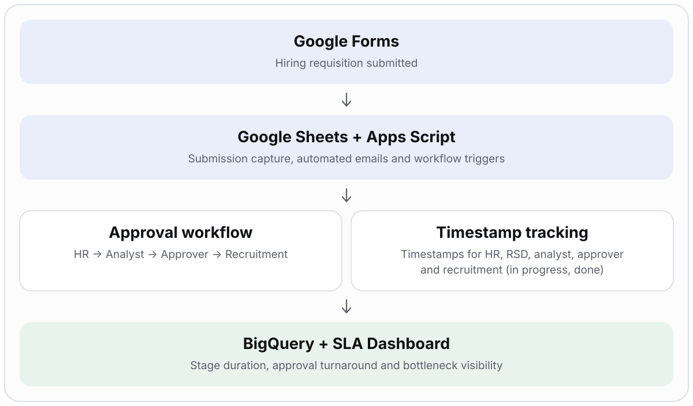
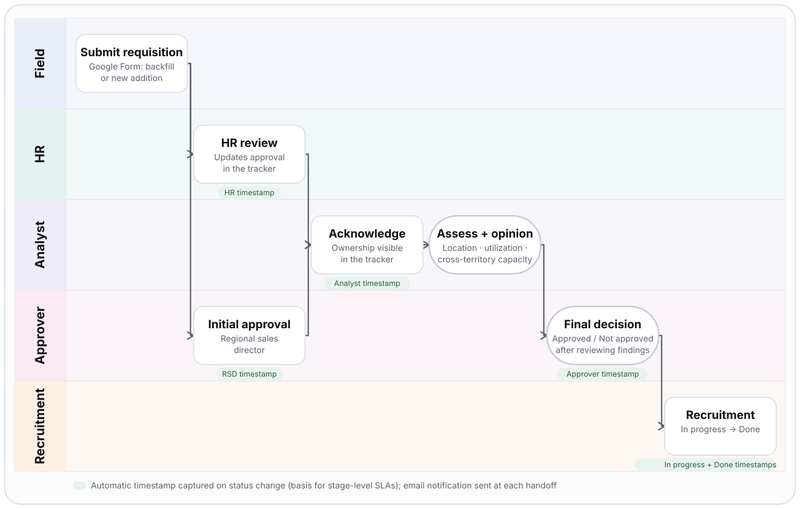

# Hiring Intake & SLA Automation

> **Cut hiring-requisition approval time from 2 weeks to 1–2 business days, and request-to-hire from 2–3 months to 15 business days,** by replacing email chains with an owned, instrumented, auditable workflow.

| | |
|---|---|
| **Role** | Program owner: problem definition, executive alignment, workflow design, requirements, automation, measurement, rollout |
| **Partners** | Field leadership (territory managers, regional sales directors), HR, Approvers, Recruitment |
| **Stack** | Google Forms · Google Sheets · Google Apps Script · BigQuery (live connector) · Tableau |
| **Measured by** | Stage-level turnaround, % within SLA (1–2 business days to approval; 15 business days request to hire), requests waiting by stage |

> Generalized from professional experience. Company identifiers, internal systems, names and proprietary approval rules are excluded.

## Problem

Field-inspector hiring requests moved through manual form submissions and sequential email follow-ups. Approval alone could take **2 weeks**, and getting from request to hire **2–3 months**, nobody could see where a request was stuck, and requests did not consistently account for local workload, dealer demand, available inspector capacity or proximity-based coverage. The result was hiring-location mismatches, avoidable travel expense, underused capacity and cross-functional friction.

## What I owned

- Defined the target process and an accountable owner for every stage
- Separated **backfill** and **new-addition** request paths at intake
- Specified the analyst assessment (strategic hiring location, territory inspector utilization, cross-territory availability) and the opinion it produces
- Built the automation: email notifications at each handoff, status-change triggers and automatic SLA timestamps
- Set the SLAs (**request to approval within 1–2 business days**; **request to hire within 15 business days**) and the review cadence for aging requests

## Architecture

## Workflow by team

| Stage | Owner | What happens | Tracker field |
|---|---|---|---|
| Intake | Field (territory manager / regional sales director) | Google Form: requester, region, territory, position type (Vehicle Condition Inspector, VCI), reason (backfill / new addition), business justification | Form submission |
| HR review | HR | Reviews the request and records approval in the tracker | HR approval + HR timestamp |
| Initial approval | Approver (regional sales director) | First-level approval, runs alongside HR review | Initial approval + RSD timestamp |
| Analyst assessment | Analyst | Acknowledges ownership, evaluates hiring location, territory utilization and cross-territory availability, and records **No objection / Objection** with notes and a potential hiring location | Analyst opinion + notes + Analyst timestamp |
| Final decision | Approver | Reviews the analyst findings and records **Approved / Not approved** | Final approver + Approver timestamp |
| Recruitment | Recruitment | Takes approved requests to **In progress → Done**, each change timestamped, so time to hire is measured the same way as approval time | Status + recruitment in-progress and done timestamps |

Every handoff sends an email notification, and every status change writes a timestamp automatically (HR, regional sales director, analyst, final approver, recruitment in progress, recruitment done).

## Delivery plan

| Phase | Work | Exit criterion |
|---|---|---|
| 1. Diagnose | Map the current journey, find handoffs and waiting time, separate delay from real review effort | Agreed as-is map and baseline |
| 2. Design | Swimlane workflow, decision inputs, approval and rejection paths | Sign-off from HR, analytics and approvers |
| 3. Build | Form, shared tracker with dropdown statuses, Apps Script triggers and notifications, timestamp capture, BigQuery connection, Tableau SLA view | Test requests flow end to end with correct notifications and timestamps |
| 4. Validate | Ran a week's worth of live requisitions (about 2 per day) across a random mix of territories | Notifications, status transitions and timestamps correct across the mix |
| 5. Roll out | Stakeholder training, decision guidance, tracker as single source of truth | New requests run on the workflow only |
| 6. Govern | Tableau SLA reporting, aging-request reviews | Bottlenecks reviewed on a recurring cadence |

## Key decisions and trade-offs

| Decision | Why | Trade-off |
|---|---|---|
| One shared tracker as the system of record | Status, decisions and ownership become visible and auditable | Needs discipline on who edits what |
| Dropdown statuses (Approved / Not approved, No objection / Objection, In progress / Done) | Consistent, analyzable values and a clean trigger for timestamps | Less free-form nuance, covered by analyst notes |
| Separate backfill and new-addition paths at intake | The two requests need different evidence | Slightly longer form |
| Required analyst assessment before final approval | Ties headcount to capacity and proximity data, not to a request alone | Adds a step, offset by clear ownership and the SLA |
| Event-driven timestamps instead of manual logging | SLA data is captured automatically at the moment of change | Depends on correct trigger configuration |
| Workspace-native tooling with a live BigQuery connector | Stakeholders already work there and reporting needs no manual export | Lighter-weight than a dedicated workflow platform |

## Risks and how they were handled

| Risk | Mitigation |
|---|---|
| Notifications fail silently | Track notification failures and overdue requests as SLA measures |
| Status edits overwrite history | Record the first transition time per stage |
| Stakeholders route around the process | Clear stage ownership, training, decision guidance, aging-request reviews |
| Tracker does not scale to analysis | Live BigQuery connector and Tableau for turnaround and bottleneck reporting |
| Defects reach live users | Validated on a week of real requisitions across a mix of territories before rollout |

## SLA measures

End-to-end turnaround in hours (request to approval, 1–2 business day SLA) · time to hire (15-business-day target) · time in each stage · % within SLA · requests waiting by stage · rework and rejection rate · notification failures and overdue requests · recruitment in-progress and completion times

## Results

- Request-to-approval turnaround reduced from **2 weeks to 1–2 business days**
- Request-to-hire time reduced from **2–3 months to 15 business days**
- Single view of request status, decisions and ownership
- Stage-level turnaround and bottleneck analysis from automated timestamps, in Tableau
- More consistent monitoring of staffing needs, field capacity and productivity indicators

## Signals this demonstrates

Program ownership · workflow orchestration · stakeholder alignment · requirements definition · process automation · SLA instrumentation · operational cost management

## Confidentiality

No source code, email addresses, spreadsheet identifiers, dealer data, individual names, proprietary approval rules or internal screenshots are included.
